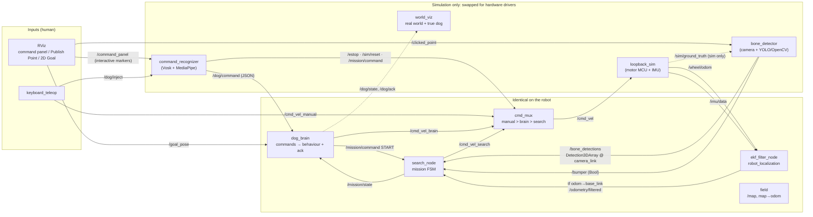
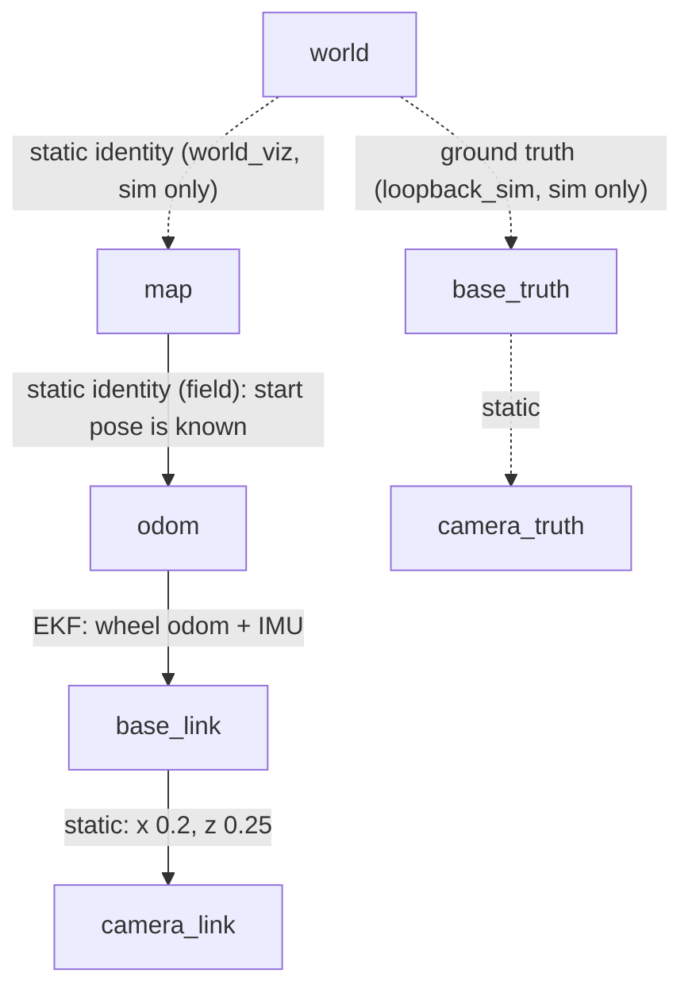
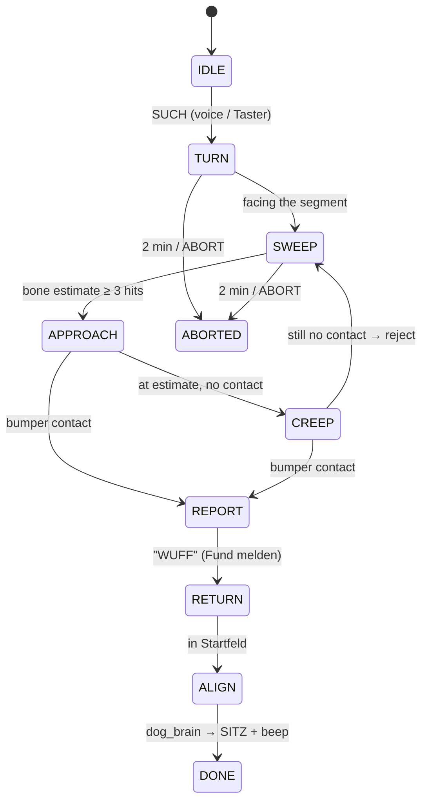

# PREN1 Dog Robot: ROS 2 Demo (digital twin)

A lightweight digital twin of the PREN1 "Hunde-Roboter", built to show the team what
ROS 2 gets us. It covers requirements **7.1 visualisation**, **7.2 testing without
hardware** and **7.3 a working version**, and it runs the full competition flow:
gestures and voice commands, **SUCH**, search, touch, report, return, sit.

No Gazebo, no Nav2, no physics. Rather than simulating sensors in detail, the sim
nodes produce the same **topics** the real drivers will publish later. Every node
marked *identical on robot* runs unchanged on the Pi.

## Quick start

```bash
run/build.sh          # colcon build --symlink-install (Python edits need no rebuild)
run/sim.sh            # sim + EKF + perception + mission + RViz
run/keyboard.sh       # 2nd terminal: keyboard driver
run/monitor.sh        # optional: mission state / acks / who drives
run/herdr_up.sh       # inside herdr: opens all of the above in one tab
run/stop.sh           # stop everything (sim, RViz, keyboard, monitor, orphaned nodes)
```

Launch args: `run/sim.sh n_bones:=3 click_adds:=true seed:=42 voice_miss_rate:=0.2 rviz:=false`

`run/env.sh` keeps ROS **local only** (domain 17, localhost discovery). It also
unsets the AIR_Week `ROS_DISCOVERY_SERVER` from `~/.bashrc`, so traffic doesn't go to the TurtleBot.

### Driving it from RViz

| What | How |
|---|---|
| Give a voice or gesture command | **Interact** tool (top-left toolbar), then click a button on the **command panel** next to the field (blue = Sprache, purple = Geste, teal = Taster/Kunststück, red = NOT-AUS) |
| Abort and go home | orange **Zurueck zum Start** button (or `z`): aborts a running search and drives back into the Startfeld |
| Move the bone | **Publish Point** tool, then click on the floor. Start with `click_adds:=true` to add bones instead |
| Send the dog somewhere | **2D Goal Pose** tool, then click and drag |
| See the result | green text above the referee = recognised, red = rejected; text above the dog = ack, posture shown by the body shape |

Gestures only work when the dog is 0.5–2 m from the person and facing them, as with the real camera.
After `SUCH` and a return, the dog stands back in the Startfeld facing the person, ready for gestures.

### Keyboard (`run/keyboard.sh`)

`w/s/a/d` or the arrow keys to drive (manual overrides autonomy), `space` to stop and hand back.
`1` SUCH · `2` HIER · `3` BRAV · `4` SITZ (voice) · `5` SITZ · `6` PLATZ · `7` AUF (gesture) · `8` Kunststück ·
`t` Taster · `x` abort · `z` zurück zum Start · `e` NOT-AUS · `r` reset · `:` type a word (`:such`, `:gesture:platz`)

From any shell: `ros2 topic pub --once /dog/inject std_msgs/String "data: voice:HIER"`

## Node architecture



### TF tree



`search_node` uses tf2 to turn each detection from `camera_link` into `map`
(`lookup_transform` at the detection timestamp, then `do_transform_pose_stamped`).
Because it relies on the **estimated** pose, localisation error shows up in the bone
estimate, just as it will on the real robot. The orange or green "estimate" disc
sits next to the true white bone.

### Odometry + IMU fusion

`loopback_sim` deliberately produces bad sensor data:

* **wheel odometry**: 3 % scale error, plus ~2°/m of heading drift (wheel diameter mismatch), plus noise
* **IMU**: integrated gyro with 1 % scale error and a small residual bias after boot calibration (no magnetometer indoors)

With the defaults, the EKF ends a full mission about 2–4° and 10 cm off. Wheels alone end about 15° off.
The IMU dominates the heading, so its quality decides everything. To show what a bad IMU does, try
`ros2 param set /loopback_sim gyro_bias_init 0.005` and then `r` (reset).

## Real world vs. robot belief

RViz uses the fixed frame `world` and splits its displays into two groups:

* **Real world (sim)**: the hall as it actually is. Tape, pylons, person and bones, plus the brown dog on its
  **true** pose (`base_truth`, with its posture and ack text) and the real camera FOV. Only the simulation has this.
* **Robot belief**: what the robot thinks. The blue `EKF` box on `base_link`, the bone estimates, the wheel/EKF paths, `/map`, TF.
  Every robot node steers by this.

Untick **Robot belief** for a clean "spectator" view. The gap between the brown dog and the blue box is the
localisation error. `world → map` is identity because the Startfeld is known, so the error lives entirely in `odom → base_link`.

`robot_localization`'s EKF (`config/ekf.yaml`) fuses the wheel velocities with the
IMU yaw and yaw rate. RViz shows three paths: **green** = ground truth,
**red** = wheel odometry only, **blue** = EKF. Drive a few loops with the keyboard
to see red drift away while blue stays close. The real robot uses the same EKF config
unchanged.

`map → odom` is a static identity, because the dog always starts at the known
Startfeld pose. For drift correction later (e.g. detecting pylons), a second
map-frame EKF would replace it. That change would be invisible to every other node.

## Nodes and topics

### Real nodes: run unchanged on the robot

| Node | Subscribes | Publishes | Notes |
|---|---|---|---|
| `ekf_filter_node` | `/wheel/odom`, `/imu/data` | tf `odom→base_link`, `/odometry/filtered` | `robot_localization`, config `ekf.yaml` |
| `field` | `/odometry/filtered` | `/map`, tf `map→odom`, `/path/fused` | `/map` optional |
| `dog_brain` | `/dog/command`, `/mission/state`, `/goal_pose` | `/cmd_vel_brain`, `/dog/ack`, `/dog/state`, `/mission/command` | `/dog/ack` drives the buzzer/LEDs |
| `search_node` | `/mission/command`, `/bone_detections`, `/bumper` | `/cmd_vel_search`, `/mission/state` | on the robot, `/bumper` comes from the bumper switch driver |
| `cmd_mux` | `/cmd_vel_manual`, `/cmd_vel_brain`, `/cmd_vel_search`, `/estop` | `/cmd_vel` | the hardware Not-Aus still cuts power |
| `camera_tf` (static) | | tf `base_link→camera_link` | set to the real camera mount |
| `keyboard_teleop` | `/dog/ack` | `/cmd_vel_manual`, `/dog/inject` | debug tool, works on both |

### Simulated nodes: replaced by hardware or dropped on the robot

| Node | Subscribes | Publishes | Real counterpart |
|---|---|---|---|
| `loopback_sim` | `/cmd_vel`, `/sim/reset` | `/wheel/odom`, `/imu/data`, `/sim/ground_truth`, tf `world→base_truth`, paths | serial/micro-ROS bridge to the ESP32/STM32 (motors, encoders, IMU) |
| `bone_detector` | `/sim/ground_truth`, `/clicked_point` | `/bone_detections` (`vision_msgs/Detection3DArray`), `/bumper` | camera + vision node, bumper switch |
| `command_recognizer` | RViz buttons, `/dog/inject` | `/dog/command` (JSON in `std_msgs/String`), `/estop`, `/sim/reset` | Vosk (KWS) + MediaPipe nodes; Not-Aus/Taster drivers |
| `world_viz` | `/dog/state`, `/dog/ack` | `/world/field`, `/world/dog`, tf `world→map` | none (spectator view only) |
| `camera_truth_tf` (static) | | tf `base_truth→camera_truth` | none |

## Search mission (search_node)



## Why ROS 2 for the team: what this demo shows

* **One interface, two implementations.** Swap the three sim nodes for hardware drivers and nothing else changes.
* **Parallel work.** ET (MCU bridge), vision, speech and mission logic only agree on topics. Nobody waits on the hardware.
* **The required "GUI" for free.** RViz covers the field, the robot, detections, mission state and the clickable commands.
* **Off-the-shelf parts.** EKF (`robot_localization`), tf2, `vision_msgs`, interactive markers: we wrote none of it.
* **Debugging.** `ros2 bag record -a` on the robot, replayed at home in this RViz. `ros2 topic echo` for any value.
* **Costs.** Learning curve for ET/MT, and Ubuntu 24.04 (or Docker) on the Pi. This demo is about 900 lines of Python.

## Known simplifications

* `/dog/command` is JSON in a `std_msgs/String`. Before the real build, create an `interfaces` package with proper messages.
* `camera_link` uses body convention (x forward), not an optical frame.
* No obstacles or collisions. Bones can't be pushed.
* Detections come from ground truth with noise and misses. Real vision has to be tested separately on recordings.

## Layout

```
run/                 env.sh build.sh sim.sh keyboard.sh monitor.sh herdr_up.sh
src/pren_demo/
  pren_demo/         one file per node + common.py (field geometry, helpers)
  config/            ekf.yaml, demo.rviz
  launch/            demo.launch.py
```
